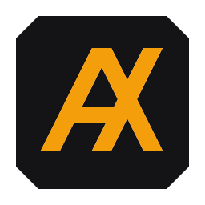

<p align="center">
  
</p>

<h1 align="center">AGX KIT</h1>

<p align="center">
  កញ្ចប់ឧបករណ៍វិស្វកម្មភ្នាក់ងារ AI ដំបូងគេសម្រាប់ Antigravity រួមមាន rules, skills, agent ឯកទេស, workflows, អង្គចងចាំយូរអង្វែង, ការណែនាំ MCP, ការសម្របសម្រួល (orchestration), និង native safety hook។
</p>

<p align="center">
  <strong>Runtime ផលិតកម្មចម្បង: Google Antigravity</strong><br/>
  <a href="./README.md">English</a> · <a href="https://agx-kit.pages.dev/km/">ឯកសារ (Docs)</a> · <a href="./MIGRATION.md">Migration guide</a> · <a href="./.github/RELEASE_SETUP.md">Release setup</a> · <a href="./SECURITY.md">Security</a>
</p>

---

## កម្រងព័ត៌មានផលិតកម្ម (Production profile)

AGX Kit ដំឡើងកិច្ចសន្យា workspace ពេញលេញនៅក្នុង `.agents/`។ Antigravity គឺជារយៈពេលដំណើរការ (runtime) ផលិតកម្មដែលត្រូវបានគាំទ្រជាផ្លូវការនៅក្នុងការចេញផ្សាយនេះ។ ឧបករណ៍ផ្សេងទៀតអាចអានឯកសារ Markdown បាន ប៉ុន្តែឥរិយាបថ runtime ក្រៅពី Antigravity មិនត្រូវបានធានាភាពត្រូវគ្នាក្នុងផលិតកម្មឡើយ។

| សមត្ថភាព | ការអនុវត្តក្នុងផលិតកម្ម |
| --- | --- |
| ការស្វែងរក Rules និង skills | `.agents/rules/`, `.agents/skills/`, `.agents/workflows/` |
| ការបញ្ជូនបន្តឯកទេស (Specialist routing) | និយមន័យតួនាទីចំនួន 24 និង intelligent-routing skills |
| បរិបទយូរអង្វែង (Persistent context) | `.agents/memory/` និងការណែនាំអំពីការបង្រួមបរិបទ (context-compression) |
| ការសម្របសម្រួល (Orchestration) | `/coordinate`, `/orchestrate`, `/agents` និង `/tasks` របស់ Antigravity |
| MCP | ការកំណត់រចនាសម្ព័ន្ធ Workspace រួមជាមួយនឹងឧបករណ៍ជំនួយសមកាលកម្មច្បាស់លាស់ និងការបម្រុងទុក |
| សុវត្ថិភាពឧបករណ៍ (Tool safety) | Native `PreToolUse` gate សម្រាប់ពាក្យបញ្ជាបំផ្លិចបំផ្លាញដែលមានកម្រិតជឿជាក់ខ្ពស់ |
| ការវេចខ្ចប់ (Packaging) | កញ្ចប់ Antigravity plugin ក្នុងម៉ាស៊ីនផ្ទាល់ រួមជាមួយបញ្ជី SHA-256 |
| ការផ្ទៀងផ្ទាត់ (Validation) | Toolkit CI, Antigravity Doctor, តេស្ត regression, Dependency Review, ការត្រួតពិនិត្យ CLI និង web |

Safety hook ដើមត្រូវបានកំណត់យ៉ាងតឹងរ៉ឹង និងជាក់លាក់។ វាទប់ស្កាត់ការលុប root-filesystem, ការ format ថាសរឹង និងការសរសេរជាន់លើ raw-disk ប៉ុន្តែនៅតែអនុញ្ញាតការសម្អាតគម្រោងធម្មតាដូចជាការលុប `dist/` ឬ `node_modules/`។ វាមិនជំនួសការគ្រប់គ្រងសិទ្ធិ (permissions), workspace trust, sandboxing ឬការយល់ព្រមពីមនុស្សរបស់ Antigravity ឡើយ។

## តម្រូវការប្រព័ន្ធ (Requirements)

- Bun 1.2 ឬថ្មីជាងនេះ សម្រាប់ឧបករណ៍ Antigravity, hooks និងតេស្តកម្រិត repository។
- Python 3.10 ឬថ្មីជាងនេះ សម្រាប់ AGX Kit validators និង utility scripts។
- Workspace Google Antigravity ដែលអាចទុកចិត្តបាន (trusted workspace)។
- Git សម្រាប់ការធ្វើបច្ចុប្បន្នភាព ការពិនិត្យឡើងវិញ និងការ rollback ប្រកបដោយសុវត្ថិភាព។

CLI ដែលបានចេញផ្សាយគាំទ្រទាំង Bun និង Node.js 18 ឬថ្មីជាងនេះ; ឧបករណ៍ repository និងការត្រួតពិនិត្យការរួមបញ្ចូល Antigravity ដំណើរការលើ Bun។

## ការចាប់ផ្តើមរហ័ស (Quick start)

### ដំឡើងទៅក្នុងគម្រោង

```bash
bun add -d github:houching/agx-kit
bunx agx-kit init
```

ឬដំឡើង CLI ជាសកល (globally):

```bash
bun add -g github:houching/agx-kit
agx-kit init
```

កុំបន្ថែម `.agents/` ទៅក្នុង `.gitignore` របស់គម្រោង ប្រសិនបើ Antigravity ត្រូវការ index rules, skills ឬ workflows។ ដើម្បីរក្សាវាទុកក្នុងម៉ាស៊ីនមូលដ្ឋានដោយមិនបិទការស្វែងរក សូមបន្ថែម `.agents/` ទៅក្នុង `.git/info/exclude` ជំនួសវិញ។

### ផ្ទៀងផ្ទាត់ workspace

```bash
bun run check:agents
bun run check:antigravity
bun run test:antigravity
```

`check:antigravity` គឺសម្រាប់តែអានប៉ុណ្ណោះ។ ឧទាហរណ៍ MCP លំនាំដើមមានផ្ទុក `YOUR_API_KEY` ដូច្នេះ doctor ធម្មតានឹងរាយការណ៍ការព្រមាន រហូតទាល់តែឧទាហរណ៍ត្រូវបានកំណត់រចនាសម្ព័ន្ធ។ ប្រើប្រាស់ strict mode លុះត្រាតែ placeholder ទាំងអស់ត្រូវបានបំពេញរួចរាល់៖

```bash
bun .agents/hooks/antigravity-doctor.mjs --strict
```

### បើកនៅក្នុង Antigravity

បន្ទាប់ពីបើក repository ជា trusted workspace៖

1. ផ្ទៀងផ្ទាត់ថា slash commands ដូចជា `/plan`, `/coordinate` និង `/orchestrate` ត្រូវបានរកឃើញ។
2. ផ្ទៀងផ្ទាត់ថា skills ពាក់ព័ន្ធត្រូវបានជ្រើសរើសពី `.agents/skills/`។
3. ដំណើរការពាក្យបញ្ជាធម្មតាដូចជា `bun test` ហើយបញ្ជាក់ថាវាត្រូវបានអនុញ្ញាត។
4. ផ្ទៀងផ្ទាត់ safety hook ជាមួយ mocked payload ជាជាងការដំណើរការពាក្យបញ្ជាបំផ្លិចបំផ្លាញពិតប្រាកដ៖

```bash
printf '%s' '{"tool_args":{"CommandLine":"rm -rf /"}}' \
  | bun .agents/hooks/validate-tool-call.mjs
```

ពាក្យបញ្ជាត្រូវតែបញ្ចប់ដោយកូដមិនមែនសូន្យ (non-zero) និងបង្ហាញ `BLOCKED by AGX Kit`។

## ការធ្វើបច្ចុប្បន្នភាពប្រកបដោយសុវត្ថិភាព និងការត្រឡប់ក្រោយ (Safe updates and rollback)

ការធ្វើបច្ចុប្បន្នភាព AGX Kit គឺដំណើរការដោយយល់ដឹងពីការច្របាច់បញ្ចូលគ្នា (merge-aware)។ ឯកសារដែលជាកម្មសិទ្ធិរបស់អ្នកប្រើប្រាស់ និងឯកសារគ្រប់គ្រងដែលត្រូវបានកែប្រែក្នុងម៉ាស៊ីនមូលដ្ឋានត្រូវបានរក្សាទុកតាមលំនាំដើម។

```bash
agx-kit update --dry-run          # មើលមុននូវផែនការជាក់លាក់
agx-kit update                    # ច្របាច់បញ្ចូលគ្នាដោយសុវត្ថិភាព និងបង្កើតការបម្រុងទុក
agx-kit update --strategy replace # ជំនួសទាំងស្រុងដោយចេតនា ប៉ុន្តែនៅតែបម្រុងទុក
agx-kit rollback                  # ស្តារឡើងវិញនូវការបម្រុងទុកចុងក្រោយបំផុតមុនការអាប់ដេត
```

Metadata នៃការអាប់ដេតត្រូវបានរក្សាទុកក្នុង `.agents/.agx-kit/`។ ការបម្រុងទុក (backups) ត្រូវបានរក្សាទុកក្នុង `.agx-kit-backups/` នៅខាងក្រៅ toolkit tree។ សូមអាន [MIGRATION.md](MIGRATION.md) មុនពេលដំឡើងកំណែចាស់ទៅកាន់កំណែ Antigravity-native។

## ការរួមបញ្ចូលបែប Antigravity-native

### កិច្ចសន្យា Runtime (Runtime contract)

`.agents/antigravity.json` ប្រកាសដំណាក់កាលរួមបញ្ចូលទាំងប្រាំមួយដែលគាំទ្រ និងសមត្ថភាព Antigravity CLI ជាផ្លូវការដែលប្រើប្រាស់ដោយ AGX Kit។ វាមិនបង្កើតកំណែ semantic version អប្បបរមាដោយខ្លួនឯងទេ នៅពេលដែលឯកសារ upstream មិនបានកំណត់ច្បាស់លាស់។

### Native safety hook

Antigravity ផ្ទុក `.agents/hooks.json` ដែលចុះឈ្មោះ៖

```json
{
  "enabled": true,
  "PreToolUse": [
    {
      "matcher": "run_command",
      "command": "bun .agents/hooks/validate-tool-call.mjs",
      "timeout": 10
    }
  ]
}
```

ដើម្បីបិទ AGX Kit hook ជាបណ្តោះអាសន្នក្នុងពេលស្វែងរកបញ្ហាភាពឆបគ្នា សូមកំណត់ `"enabled": false`, បើក workspace ឡើងវិញ ហើយរាយការណ៍អំពីទម្រង់ payload ជាលក្ខណៈឯកជន ប្រសិនបើវាអាចមានផ្ទុកទិន្នន័យរសើប។ កុំលុបការគ្រប់គ្រងសិទ្ធិរបស់ Antigravity ផ្ទាល់ឡើយ។

### ការកំណត់រចនាសម្ព័ន្ធ MCP (MCP configuration)

ពិនិត្យមើលផែនការ MCP នៃ workspace ដោយមិនសរសេរចូលទៅកាន់ home directory៖

```bash
bun .agents/hooks/sync-mcp.mjs --check
bun .agents/hooks/sync-mcp.mjs --print
```

បន្ទាប់ពីជំនួស placeholder រួច សូមអនុវត្តយ៉ាងច្បាស់លាស់ទៅកាន់គោលដៅដែលគាំទ្រណាមួយ៖

```bash
bun .agents/hooks/sync-mcp.mjs --apply --target suite
bun .agents/hooks/sync-mcp.mjs --apply --target cli
```

Servers ដែលមានឈ្មោះដូចគ្នាដែលមានស្រាប់ត្រូវបានរក្សាទុក លើកលែងតែមានការផ្តល់ជម្រើស `--force`។ ការបម្រុងទុកដែលមាន timestamp ត្រូវបានបង្កើតឡើង មុនពេលឯកសារគោលដៅដែលមានស្រាប់ត្រូវបានផ្លាស់ប្តូរ។ កុំ commit ព័ត៌មានសម្ងាត់ MCP ពិតប្រាកដចូលក្នុង repository ឡើយ។

### បង្កើត និងពិនិត្យមើល plugin (Build and inspect the plugin)

```bash
bun run build:antigravity-plugin
```

ពិនិត្យមើល `dist/antigravity-plugin/` មុនពេលដំឡើងក្នុងម៉ាស៊ីនផ្ទាល់។ Bundle មានផ្ទុក packaged skills, agents, rules, ពាក្យបញ្ជា workflow ដែលបានបំប្លែង, native hook, ឧទាហរណ៍ MCP, និង `PLUGIN_CONTENTS.json` ដែលមាន SHA-256។

```bash
agy plugin install ./dist/antigravity-plugin
agy plugin list
```

ការដំឡើង Plugin គឺជាជម្រើសបន្ថែម; `.agents/` ក្នុង repository នៅតែជាប្រភពនៃការពិត (source of truth) សម្រាប់ការអភិវឌ្ឍគម្រោង។

## សមាសភាគដែលបានរួមបញ្ចូល (Included components)

| Component | Count | Purpose |
| --- | ---: | --- |
| Agents | 24 | និយមន័យតួនាទីឯកទេស និងការសម្របសម្រួល |
| Skills | 56 | ចំណេះដឹងជំនាញតាមតម្រូវការ និងឧបករណ៍ជំនួយផ្ទៀងផ្ទាត់ដែលអាចដំណើរការបាន |
| Workflows | 16 | នីតិវិធី slash command ដែលអាចធ្វើឡើងវិញបាន |
| Rules | 7 | ការកំណត់ routing, spec-gate, សុវត្ថិភាព, ការរចនា និងកូដសម្រាប់ workspace ទាំងមូល |
| Memory topics | 4 required topics plus index | អនុសញ្ញាគម្រោង, ការសម្រេចចិត្ត, ចំណូលចិត្ត និងមតិកែលម្អយូរអង្វែង |

រាល់ agent, skill, workflow និង rule សុទ្ធតែមានកិច្ចសន្យា SemVer។ `.agents/manifest.json`, `.agents/manifest.lock.json` និង `.agents/DEPENDENCY_GRAPH.md` ធ្វើឱ្យ toolkit អាចបង្កើតឡើងវិញបានត្រឹមត្រូវ និងរកឃើញរាល់ភាពខុសប្រក្រតី។

```bash
bun run generate:agents
bun run check:agents
```

## លំហូរការងារទូទៅ (Common workflows)

| ពាក្យបញ្ជា | គោលបំណង |
| --- | --- |
| `/brainstorm` | ស្វែងយល់ពីជម្រើស និងស្ថាបត្យកម្មមុនពេលអនុវត្តជាក់ស្តែង |
| `/coordinate` | ដំណើរការកិច្ចការស្រាវជ្រាវ ឬការពិនិត្យឡើងវិញស្របគ្នា រួចសំយោគលទ្ធផល |
| `/create` | បង្កើតមុខងារ ឬកម្មវិធីជាមួយនឹងដំណាក់កាលត្រួតពិនិត្យច្បាស់លាស់ |
| `/debug` | វិភាគរកមូលហេតុដើមដោយផ្អែកលើភស្តុតាងជាក់ស្តែង |
| `/deploy` | ដំណើរការត្រួតពិនិត្យមុនការដាក់ឱ្យប្រើប្រាស់ និងលំហូរការងារដាក់ឱ្យដំណើរការផលិតកម្ម |
| `/enhance` | កែប្រែ codebase ដែលមានស្រាប់ដោយសុវត្ថិភាព |
| `/orchestrate` | រៀបចំផែនការ, សុំការអនុម័ត, ចាត់ចែងភារកិច្ចទៅកាន់ agent ជំនាញ និងផ្ទៀងផ្ទាត់ |
| `/plan` | បង្កើតផែនការអនុវត្តលម្អិត និងបញ្ជីផ្ទៀងផ្ទាត់ |
| `/preview` | គ្រប់គ្រង preview server ក្នុងម៉ាស៊ីនផ្ទាល់ |
| `/remember` | រក្សាទុកព័ត៌មានគម្រោងយូរអង្វែងទៅក្នុងអង្គចងចាំ |
| `/spec` | បង្កើត ឬបញ្ជាក់លម្អិតអំពី functional specification (`specs/<slug>/spec.md`) |
| `/spec-archive` | បញ្ចូល delta ទៅក្នុង `specs/living/` និងរក្សាទុក spec ដែលបានបញ្ចប់ |
| `/spec-verify` | ផ្ទៀងផ្ទាត់ spec ↔ plan ↔ code ↔ memory ជាមួយភស្តុតាងប្រតិបត្តិការជាក់ស្តែង |
| `/status` | សង្ខេបការងារសកម្ម និងបញ្ហាស្ទះ |
| `/test` | រចនា និងដំណើរការតេស្ត |
| `/verify` | បង្ហាញភស្តុតាងនៃការផ្លាស់ប្តូរតាមរយៈការដំណើរការជាក់ស្តែង ជាជាងគ្រាន់តែមើលកូដ |

## ដំណាក់កាលត្រួតពិនិត្យការចេញផ្សាយ និងផលិតកម្ម (Release and production gates)

Release candidate មិនទាន់ត្រូវបានចាត់ទុកថាជា production-approved នោះទេ រហូតទាល់តែការត្រួតពិនិត្យស្វ័យប្រវត្តិទាំងអស់ និងការធ្វើតេស្តជាក់ស្តែង Antigravity នៅក្នុង [RELEASE_SETUP.md](.github/RELEASE_SETUP.md) ត្រូវបានបញ្ចប់រួចរាល់។

ការត្រួតពិនិត្យ GitHub ដែលតម្រូវជាចាំបាច់៖

- Toolkit validation
- CLI tests and package validation
- Web lint, typecheck, build, and audit
- Antigravity native contract
- Dependency Review

AGX Kit មិនតម្រូវឱ្យមានការ merge ដោយស្វ័យប្រវត្តិ, ការដាក់ឱ្យដំណើរការដោយស្វ័យប្រវត្តិ ឬការធ្វើសមកាលកម្ម MCP ដោយស្វ័យប្រវត្តិនោះទេ។ ការផ្លាស់ប្តូរក្នុងផលិតកម្មត្រូវតែអាចពិនិត្យឡើងវិញ និងអាចត្រឡប់ក្រោយ (reversible) បានជានិច្ច។

## ឯកសារ (Documentation)

- [ព័ត៌មានលម្អិតអំពីការអនុវត្តលើ Antigravity](.agents/hooks/README.md)
- [មគ្គុទ្ទេសក៍បម្លាស់ប្តូរ (Migration guide)](MIGRATION.md)
- [គោលការណ៍សុវត្ថិភាព និងគំរូហានិភ័យពេលដំណើរការ](SECURITY.md)
- [ស្ថាបត្យកម្មលំហូរ Agent](AGENT_FLOW.md)
- [ស្ថាបត្យកម្ម Toolkit](.agents/ARCHITECTURE.md)
- [កំណត់ហេតុនៃការផ្លាស់ប្តូរ (Changelog)](CHANGELOG.md)
- [ការរៀបចំការចេញផ្សាយ](.github/RELEASE_SETUP.md)

## ឯកសារយោង និងការបញ្ជាក់ប្រភព (References and attribution)

AGX Kit គឺជាការអនុវត្តកូដបើកចំហ (open-source) ដើមនៃទម្រង់វិស្វកម្មភ្នាក់ងារផ្អែកលើ Markdown។ មិនមាន file កូដកម្មសិទ្ធិផ្តាច់មុខត្រូវបានបញ្ចូលនោះទេ។ ការសម្រេចចិត្តរួមបញ្ចូល runtime គឺផ្អែកលើឯកសារ Antigravity ជាសាធារណៈ និង codelabs ដែលមានតំណភ្ជាប់នៅក្នុង [.agents/hooks/README.md](.agents/hooks/README.md)។

## គាំទ្រគម្រោង (Support the project)

ប្រសិនបើ AGX Kit ជួយសម្រួលដល់ការងារអភិវឌ្ឍន៍របស់អ្នក អ្នកអាចគាំទ្រគម្រោងតាមរយៈ៖

<p align="center">
  <a href="https://www.patreon.com/houching"><strong>គាំទ្រតាមរយៈ Patreon (Support on Patreon)</strong></a>
</p>

## អាជ្ញាប័ណ្ណ (License)

ចេញផ្សាយក្រោម [MIT License](LICENSE) © [houching](https://github.com/houching)។ សូមមើល [THIRD_PARTY_NOTICES.md](THIRD_PARTY_NOTICES.md) សម្រាប់ការផ្តល់កិត្តិយសដល់ភាគីទីបី និងការជូនដំណឹងអំពីពាណិជ្ជសញ្ញា។
